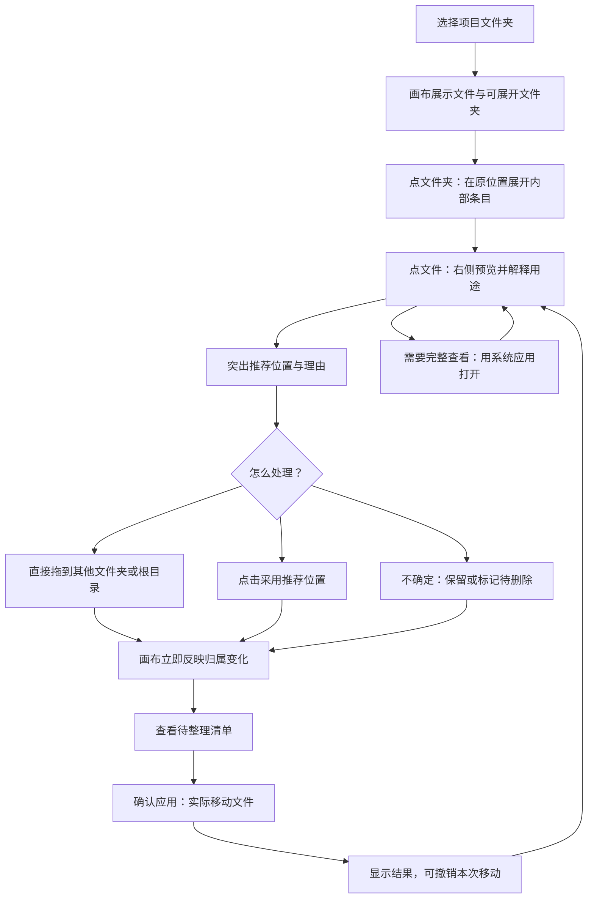

# 下一版规划：展开式整理与文件解释

日期：2026-10-16。本文保留原始产品规划。当前开发版已实现下面的首轮闭环与待删除标记，操作和限制见 [开发体验与验收](展开式整理_开发体验与验收.md)。已发布的 0.3.0 EXE 不包含本轮改动。

## 核心目标

用户在同一张画布上完成：展开文件夹 → 看懂文件 → 看见推荐位置 → 拖动或采用建议 → 核对并完成整理。

原 0.3.0 虽然扩大了画布，但文件夹内部仍需要切换层级操作，AI 也需要进入单独的问答流程。本轮优先改变这两处交互。

## 用户完整流程

模型和项目读取范围首次设置；之后在已授权范围内，点击文件即可分析，不再要求用户手动建立索引、准备资料、切换助手、重复输入“这是什么文件”。本地预览立即显示，AI 分析异步补上；相同文件未修改时复用结果。

最终“应用”是明确的一步：画布拖动先形成整理计划，用户可以连续调整，最后一次确认后实际移动。首版真实执行仅限所选项目内的普通文件移动，不覆盖已有文件；执行前检查源文件是否变化，失败时逐项显示结果，撤销依据实际成功的操作记录。

## 同屏展开的文件夹

文件夹显示为有边界、有名称的容器。点击标题旁的展开按钮，容器在原位置展开，里面显示真正可选择、预览和拖动的文件卡片。多个文件夹可同时展开，展开新文件夹不会替换当前画面；支持继续展开内部子文件夹。

| 操作                         | 用户看到的结果                                             |
| ---------------------------- | ---------------------------------------------------------- |
| 把文件拖入展开的文件夹       | 文件夹边界高亮，放下后文件进入该容器                       |
| 把文件拖入折叠的文件夹       | 标题高亮；短暂停留自动展开，方便放到内部子文件夹           |
| 把内部文件拖出边界           | 移到上层空白区域或其他文件夹；不需要先返回上一级           |
| 跨两个已展开文件夹拖动       | 文件直接从一个容器移动到另一个容器                         |
| 拖动文件夹标题               | 整个文件夹连同内部布局一起移动；仅调整位置时不改变磁盘归属 |
| 折叠再展开                   | 文件归属和布局保留；展开时自动让出空间，减少卡片遮挡       |
| 从右侧文件列表或文件标题拖动 | 拖的是同一文件，可放入画布中的文件夹；正文仍支持正常选字   |

统一规则：**拖动时目标高亮、显示即将放入的路径；松手后文件落在目标容器内。** 文件可见的卡片、列表项和标题均有拖动入口；预览正文不整块设为拖拽区域，以保留选字和复制。

画布空白处明确表示“项目根目录”或当前容器的上层区域，避免用户猜测拖出去会去哪里。嵌套容器以鼠标下最内层的合法文件夹为目标。拒绝文件夹放入自身或其子孙；同名冲突保留原状态并给出可操作提示。

## 右侧：先解释，再给一个明确建议

点击文件后，右侧统一显示内容预览和 AI 解读，不再把两者分成互斥的侧栏。优先展示以下顺序：

1. **是什么**：一句话说明文件用途，例如“这是一份校园拍摄的执行方案”。
2. **包括什么**：两三条主要内容，例如拍摄地点、交付数量、截止时间。
3. **在项目里的作用**：结合项目说明和相关文档解释关联，例如“它规定了封面素材的拍摄要求，与交付清单有关”。
4. **最推荐的处理**：突出一个主操作，例如“移到：项目 / 拍摄资料”，下面写具体理由，画布同步高亮目标文件夹。
5. **证据与追问**：可展开查看依据的文件与原文片段；下方直接输入“为什么放这里？”或“它和另一份有什么区别？”。

文件名、类型、大小和路径作为次要信息。长对话放在下方，避免盖住当前文件的主要解释和推荐动作。推荐目标不存在时明确显示“新建‘拍摄资料’并移入”，采用后在画布上出现该文件夹。

AI 的处理建议分为：保留、移动、归档、待删除。资料不足时显示“暂时无法判断，建议保留”，不强行给结论；未提取正文时显示“仅依据文件名”，不假装读过文件。

“建议删除”必须带理由和依据，例如内容哈希完全相同的副本。文件名包含“旧版”“临时”不能单独作为删除依据；当前索引没检索到引用，也不能证明文件无人使用。首版只标记“待删除”，集中展示候选及理由，不执行永久删除。

## 多种打开方式

- **单击文件**：右侧简要预览、用途解释和推荐动作。
- **双击文件 / 点击“用系统应用打开”**：用系统默认应用打开当前真实文件，例如 Word、图片查看器或代码编辑器。
- **指定其他程序**：后续增加“打开方式…”入口，首版先用“内置预览 + 系统默认应用”跑通两种打开途径。

外部打开可能编辑真实文件，返回后刷新元数据和分析缓存；不要继续显示已经过时的用途解释。外部应用修改不属于画布移动的撤销范围。

## AI 怎样结合项目理解文件

后台自动建立当前项目的轻量内容索引。分析所选文件时提供它的正文、所在路径、项目说明、相关文档片段，以及用户可选填写的一句话目标。先找项目内的相关内容，再给出有证据的解释与位置建议。

界面保留“AI 使用范围”入口，展示当前模型服务、授权目录和排除项。云端分析只在已授权范围内触发，超出范围需重新授权；本地索引本身不调用云模型。结果按文件变化、模型配置及项目目标变化失效。引用依据能定位回对应文件，不以模型的自述代替实际检索证据。

首轮重点支持 TXT、Markdown、CSV 和已有图片预览。PDF、DOCX 正文提取作为下一批格式扩展；图片语义理解、扫描件 OCR 暂缓。格式不支持时仍可手动拖动并通过系统应用打开。

## 首版范围和实现顺序

| 顺序 | 交付内容                                                 | 验收方式                                                             |
| ---- | -------------------------------------------------------- | -------------------------------------------------------------------- |
| 1    | 同屏展开容器、跨容器拖入拖出、明确落点、多选及撤销       | 同时展开两个文件夹，不切换页面即可交换文件；嵌套子目录也能放入与拖出 |
| 2    | 合并内容预览和文件解释、系统默认应用打开                 | 点文件即看到内容；系统应用能打开同一真实文件                         |
| 3    | 项目内容辅助解释、一个突出的位置建议、点击采用与继续追问 | 不输入固定问题，也能看见用途和推荐；采用后目标容器与归属同步变化     |
| 4    | 待整理清单、确认实际移动、执行记录与受控撤销             | 普通样例文件实际进入推荐位置，随后撤销能恢复原路径；冲突不覆盖       |
| 5    | 待删除标记及理由                                         | 候选可检查、可取消，原文件没有被删除                                 |

先把前四步做成一条完整闭环，再扩展批量 AI 自动整理、全电脑知识库、复杂打开方式、PDF/Office/OCR 和真实删除。

建议演示场景：两个文件夹与六个文件。用户展开两个文件夹，点选一份拍摄方案，看到用途与推荐；先手动拖动一份文件，再采用一次 AI 推荐；用系统应用打开检查，最后确认移动并撤销。全程不依赖切换文件夹页面，也不要求用户理解索引和上下文配置。

## 开发与验证方式

按用户最新要求，默认在开发模式中修改与验证：前端热更新，主进程变更后重启开发程序；不再每次打包 EXE。需要发布版时再打包。

现有项目已有 Git。实现时按上述阶段保留版本；真实文件操作先在专用样例目录验收，核对源文件和目标文件、冲突处理、失败记录及撤销结果，再用于日常项目。
